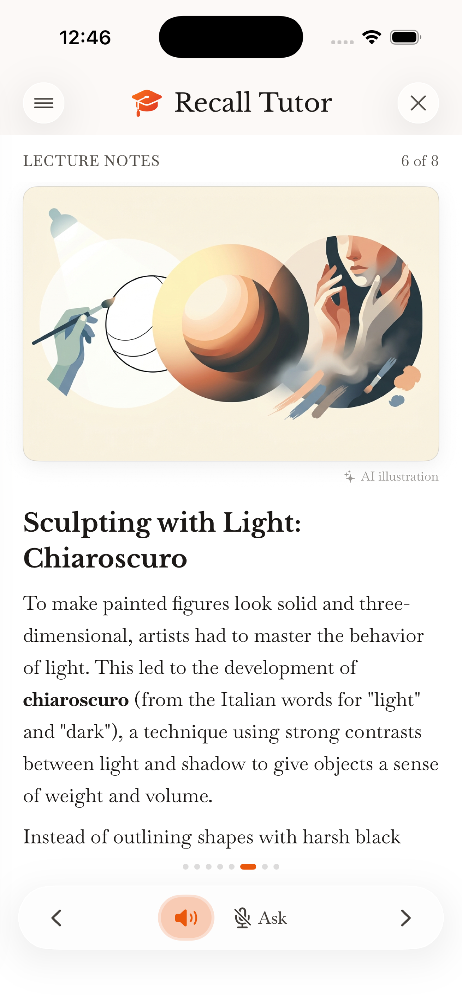
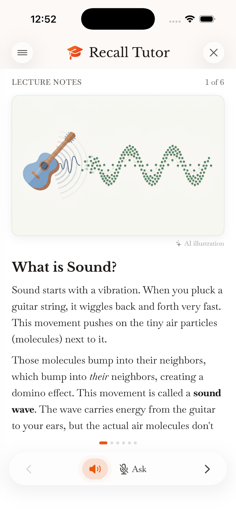
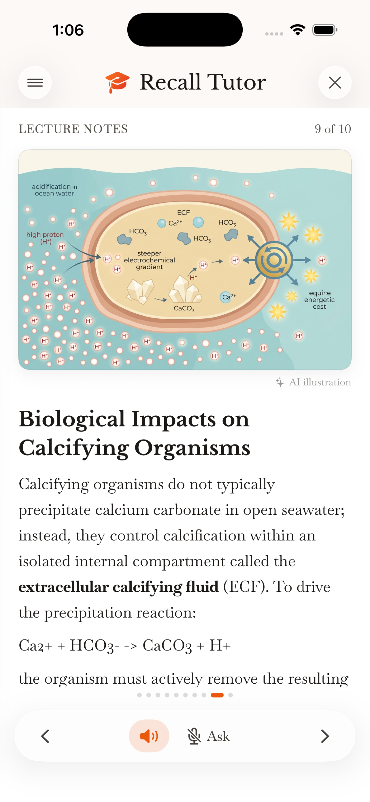

# Recall Tutor (iOS)

A study app that turns any topic into a short lecture of visual cards, a recall quiz, and a voice tutor you can interrupt with questions. [On the App Store](https://apps.apple.com/us/app/recall-tutor/id6789984919).

<p>
  
  
  
</p>
<!-- TODO: short screen recording of Ask interrupting the voice tutor -->

## How it works

- **Lecture generation:** a topic plus a reading level (Elementary → University) is turned into a structured lecture, then split into cards (`Logic/CardSplitter.swift`). Dense cards get a generated illustration, cached per lecture.
- **Recall quiz:** questions are generated from the lecture and aim at understanding rather than verbatim recall. Mastery is tracked per topic.
- **Voice tutor:** a realtime audio session (Gemini Live or the OpenAI Realtime API) reads each card aloud and answers spoken questions. Tapping *Ask* interrupts it mid-sentence.
- **Providers:** one `ChatModel` interface over Anthropic, OpenAI, Gemini and Firebase AI. Users can bring their own key (stored in the Keychain) or use a metered built-in tier gated by Firebase Auth and StoreKit 2.

```
SwiftUI views ─► ChatModel ─┬─ AnthropicClient
                            ├─ OpenAIClient / OpenAIRealtimeSession
                            ├─ GeminiClient / GeminiLiveSession
                            └─ FirebaseAIClient (managed tier, metered)
LiveAudio (AVAudioEngine) ◄─► realtime session        SubscriptionManager (StoreKit 2)
```

## Stack

Swift · SwiftUI · AVAudioEngine · StoreKit 2 · Firebase Auth / Firebase AI · Keychain · iOS 26

## Run it

1. Open `RecallTutor.xcodeproj` in Xcode 26 and set your signing team.
2. Build and run. Without Firebase configured, the app runs in bring-your-own-key mode: add an Anthropic, OpenAI or Gemini key in **Settings**.
3. Optional: to enable the managed tier, follow [FIREBASE.md](FIREBASE.md). `RecallTutor.storekit` provides local subscription testing.
